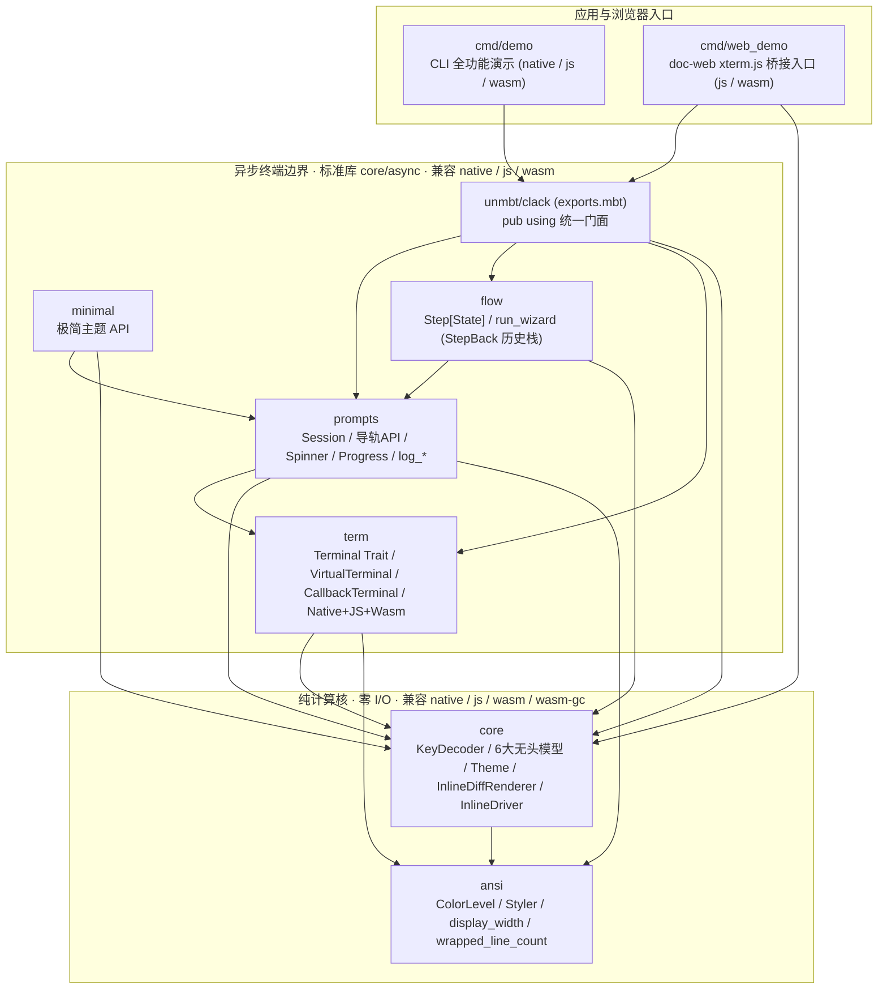
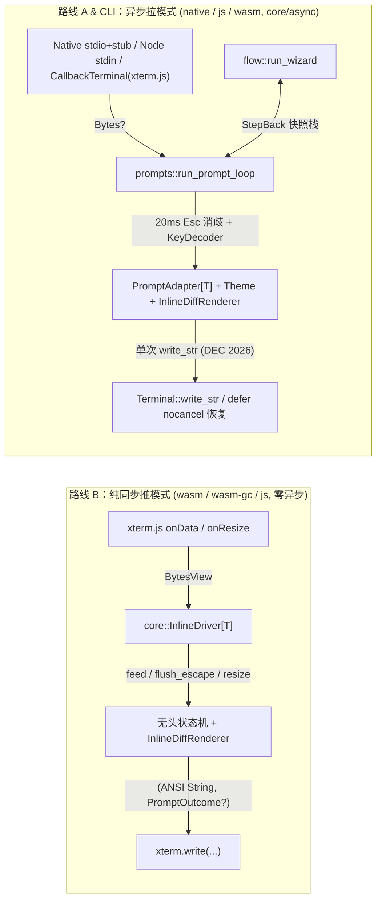

# 参考实现剖析与 MoonBit 版架构设计总结

本文档汇总 `unmbt/clack` 在设计阶段对上游原版 [bombshell-dev/clack](https://github.com/bombshell-dev/clack)（本地只读参考副本位于 `clack/clack/`）、极简交互库 [terkelg/prompts](https://github.com/terkelg/prompts)、[unmbt/moonset](../../moonset/) 内联 TUI 以及社区 [moonbit-community/tty](https://github.com/moonbit-community/tonyfettes-tty) 的源码级评估、借鉴与扬弃决策，并凝练为 MoonBit 版的全景架构设计。

---

## 1. 原版 `bombshell-dev/clack` 架构剖析

原版 Clack（v1.x）采用双包 Monorepo 结构：

### 1.1 `@clack/core`（交互核心与行内差分基类）

1. **基类状态机与事件总线（`packages/core/src/prompts/prompt.ts`、`types.ts`）**：
   - 以面向对象继承 `class Prompt<TValue>` 统领所有题型（`TextPrompt`、`PasswordPrompt`、`ConfirmPrompt`、`SelectPrompt`、`MultiSelectPrompt`、`GroupMultiSelectPrompt`、`AutocompletePrompt`、`DatePrompt`、`MultiLinePrompt`、`SelectKeyPrompt`）。
   - 定义六态机 `ClackState = 'initial' | 'active' | 'cancel' | 'submit' | 'error' | 'validating'`（其中 `validating` 专用于异步校验期间屏蔽输入并渲染校验中提示）。
   - 通过 `EventEmitter` 式回调（`on`/`once`/`emit`）派发 `'cursor'`、`'key'`、`'value'`、`'userInput'`、`'confirm'`、`'finalize'` 等内部事件，由子类订阅更新自身状态。
2. **语义动作与可配置别名（`packages/core/src/utils/settings.ts`）**：
   - 将底层按键映射为语义动作 `Action = 'up' | 'down' | 'left' | 'right' | 'space' | 'enter' | 'cancel'`，非文本输入组件自动启用 `j`/`k`/`h`/`l`（Vim 方向别名）、`\x03` 与 `escape` 等默认别名映射。
3. **行级差分重绘与视口预算（`prompt.ts`、`utils/string.ts`）**：
   - 在 `render()` 中先用 `fast-wrap-ansi` 按 `getColumns(output)` 折行，若 `frame === _prevFrame` 直接短路跳过写出；
   - 通过 `diffLines(_prevFrame, frame)` 定位变化行：单行变化时只移动光标并单行擦除重写，多行变化时从首个变化行开始擦至屏底并重写，且通过 `rows = getRows(output)` 偏移处理避免超屏重绘错位。
4. **原生阻塞与无障碍配置（`utils/index.ts`、`settings.ts`）**：
   - `block()` 在 `Spinner` 等非输入等待期间开启 raw mode 隐藏光标并吞掉按键回显，遇到取消键时恢复光标并退出；
   - 通过 `isAccessible()`（入参 > 全局 `settings` > `ACCESSIBLE` 环境变量）决定是否关闭动画改用纯静态无障碍输出。

### 1.2 `@clack/prompts`（视觉壳层与工作流辅助）

1. **视觉符号与导轨装配（`packages/prompts/src/common.ts`）**：
   - 集中维护 `S_STEP_ACTIVE`（`◆`）、`S_STEP_SUBMIT`（`◇`）、`S_BAR`（`│`）、`S_BAR_START`（`┌`）、`S_BAR_END`（`└`）等 Unicode 符号及其 ASCII 回退，支持 `withGuide` 开关与 `formatInstructionFooter`。
2. **防溢出视口裁剪（`packages/prompts/src/limit-options.ts`）**：
   - `limitOptions()` 不只按选项个数截断，而是先按 `columns - columnPadding` 逐项折行统计真实物理行数，再按 `rows - rowPadding` 预算从非光标侧裁剪并补全上下 `...` 省略号。
3. **Spinner、Progress 与 TaskLog（`spinner.ts`、`progress-bar.ts`、`task-log.ts`）**：
   - `spinner()` 支持 `indicator: 'dots' | 'timer'`（末尾附加 `[1m 12s]` 计时器）、`accessible` 30 秒心跳输出、`block()` 防键盘干扰；
   - `taskLog()` 支持在执行期间流式输出日志缓冲区，成功时折叠清屏、失败时保留完整现场日志，并用 `stripDestructiveANSI()` 剔除光标移动/清屏等破坏性转义序列；
   - `group()` 按对象属性顺序串行执行一组问答并将已填 `results` 传给下一步（但不支持向后回退）。

---

## 2. 借鉴与扬弃矩阵（Adopt vs Rethink）

| 机制/设计点 | 原版 Clack 做法 | MoonBit 版决策（`unmbt/clack`） | 原因与工程收益 |
| :--- | :--- | :--- | :--- |
| **核心与视觉分层** | `@clack/core` + `@clack/prompts` | **吸收**：`core`（纯状态机+渲染协议）+ `prompts`/`minimal` | 同一套无头状态机无缝支撑导轨与极简双主题 |
| **动作别名隔离** | `_track` 控制是否触发 `j/k/h/l` | **吸收**：`Select`/`Confirm` 等激活 `j`/`k`/`h`/`l`，`Text`/`Autocomplete` 禁止拦截 | 防止搜索或输入字符时误触发选项跳转 |
| **六态机与异步校验** | `'initial'..'validating'` | **吸收**：`PromptPhase` 纳入 `Validating` 态 | 为异步校验与复杂提交前检查保留标准状态渲染 |
| **帧相等短路与行预算裁剪** | `frame === _prevFrame` 跳过；`limitOptions` 按折行物理行数裁剪 | **吸收并升级**：`InlineDiffRenderer` 短路相等帧；列表窗口按 `rows` 物理行数钳制并补 `...` | 消除无意义闪烁，彻底杜绝长列表顶出可视区进入 scrollback |
| **Spinner 键盘屏蔽与计时** | `block()` + `indicator: 'timer'` | **吸收**：`Spinner` 期间静默消费非 `Ctrl+C` 按键，支持 `show_timer` 与 `with_guide` | 防止用户误敲字符污染加载动画帧 |
| **v0.2 候选能力** | `taskLog`、`box`、`selectKey`、`tasks` | **吸收规划**：`v0.1` 聚焦核心表单+`Spinner`/`Progress`/`log`，`task_log`（含 `stripDestructiveANSI`）等列入 `v0.2` 演进池 | 控制首版交付边界，保持接口精简稳定 |
| **OOP 继承与 EventEmitter** | `class Prompt` + `on/emit` | **扬弃重塑**：纯数据状态机 + `FrameSpec` + `PromptAdapter[T]`（[ADR-003](decisions/003-prompt-model-abstraction.md)） | MoonBit 无类继承与 trait 关联类型；纯数据转换支持四目标（含 `wasm-gc`）零 I/O 单测 |
| **全局可变 `settings` 与 `CANCEL_SYMBOL`** | 全局单例 + `Symbol` 哨兵 | **扬弃重塑**：显式不可变 `Session` + `PromptOutcome[T]` 枚举（`Submitted` / `Cancelled` / `StepBack`） | 消除并发/测试污染，编译器强制穷尽处理取消与回退分支 |
| **`node:readline` 输入耦合** | 依赖 Node `readline` 与 `setRawMode` hack | **扬弃重塑**：零 I/O `KeyDecoder`（原生 Bracketed Paste + 20ms `Esc` 消歧）+ `Terminal` trait（[ADR-004](decisions/004-terminal-lifecycle-and-resize.md)） | 彻底摆脱运行时特定输入库，同时覆盖 Native、Node/Web `xterm.js` 与 `VirtualTerminal` |
| **多步向导 `group()`** | 单向顺次执行，无法回退 | **扬弃重塑**：`@flow.run_wizard` 维护 `(step_index, prior_state)` 快照历史栈 | 原生支持 `Esc` / `Shift+Tab` 跨跳过步骤精准回退重填 |
| **多段零散 `write()`** | 光标移动、擦除、内容分多次写出 | **扬弃重塑**：整帧字节流合并为单次写入并包裹 DEC Mode 2026（`\x1b[?2026h...\x1b[?2026l`） | 在 Windows Terminal / xterm.js 等现代终端实现真正零撕裂刷新 |

---

## 3. MoonBit 版 `unmbt/clack` 全景架构设计总结

### 3.1 分层有向无环（DAG）包拓扑

### 3.2 双驱动数据流（CLI 异步拉模式 vs 浏览器 `xterm.js` 双路线）

### 3.3 核心概念映射对照表

| 概念维度 | 原版 `@clack` | `unmbt/clack` 对应设计 |
| :--- | :--- | :--- |
| **组件状态抽象** | `class Prompt<T>` 继承体系 | 具体结构体（`TextModel` 等）+ 统一 `PromptAdapter[T]`（[ADR-003](decisions/003-prompt-model-abstraction.md)） |
| **结果与取消语义** | `T \| typeof CANCEL_SYMBOL` | 强类型枚举 `PromptOutcome[T]`：`Submitted(T) \| Cancelled \| StepBack` |
| **视觉定制** | `@clack/prompts` 硬编码模板函数 | 可插拔 `Theme` trait（内置 `ClackTheme` & `MinimalTheme`）+ `Session` |
| **多步编排** | `group()`（不可回退） | `@flow.run_wizard`（支持条件 `when` + `StepBack` 历史快照栈） |
| **终端 I/O** | `node:process` + `node:readline` | `@term.Terminal` trait（`native_stub.c` / `term_js` / `term_wasm` / `CallbackTerminal` / `VirtualTerminal`） |
| **CI 与非交互降级** | 依赖 `isCI()` 分散判断 | 统一 `NonInteractivePolicy`（`UseDefaults` / `Fail`）+ `ColorLevel` 环境探测 |

---

## 4. 其他参考实现与取舍说明

1. **[terkelg/prompts](https://github.com/terkelg/prompts)**：贡献了 `MinimalTheme` 的单行紧凑问答视觉语义（`?` / `✔` / `›`），剔除了其依赖单线程阻塞回调与全局隐式样式的旧实现。
2. **[unmbt/moonset/cli/tui_*](../../moonset/cli/)**：直接验证并输出了 4 项跨平台工程经验——Windows `WriteConsoleW` 无乱码输出、保留 `ENABLE_QUICK_EDIT_MODE` / `ENABLE_EXTENDED_FLAGS`、`step_cell_width` 东亚/Emoji/ZWJ 宽度精确计算、以及 `GroupMultiSelect` 分组多选树形交互；[moonset/doc-web](../../moonset/doc-web/) 提供了 Vite + React + `@xterm/xterm` v6 文档站集成模板。
3. **[moonbit-community/tty@0.6.2](https://github.com/moonbit-community/tonyfettes-tty)**：功能完备但绑定外部 `moonbitlang/async`、不支持 `js`、内嵌 9.89 MB sidecar 二进制并在运行时释放执行，不作为核心默认依赖，详见 [ADR-001](decisions/001-tty-backend-strategy.md)。
4. **[sennenki/pretty_prompt@0.1.2](https://mooncakes.io/docs/sennenki/pretty_prompt@0.1.2)**：定位为 REPL 代码行编辑器（历史文件、`Ctrl+R`、语法高亮），与本项目脚手架交互向导赛道正交。

---

## 5. 上游参考目录清理说明

仓库内的 `clack/clack/` 目录仅为设计剖析阶段临时留存的原版 TypeScript 参考源码。进入 Phase 0 编码前，应将该目录纳入 `.moonignore`（并按需移出仓库或写入 `.gitignore`），避免其 `package.json` / `node_modules` 或大量 Markdown/TS 文件干扰 `moon` 工具链或污染发布包体积。
